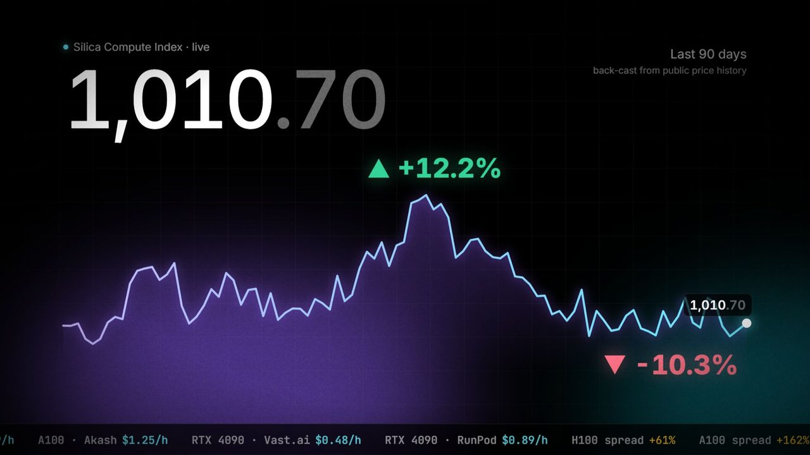
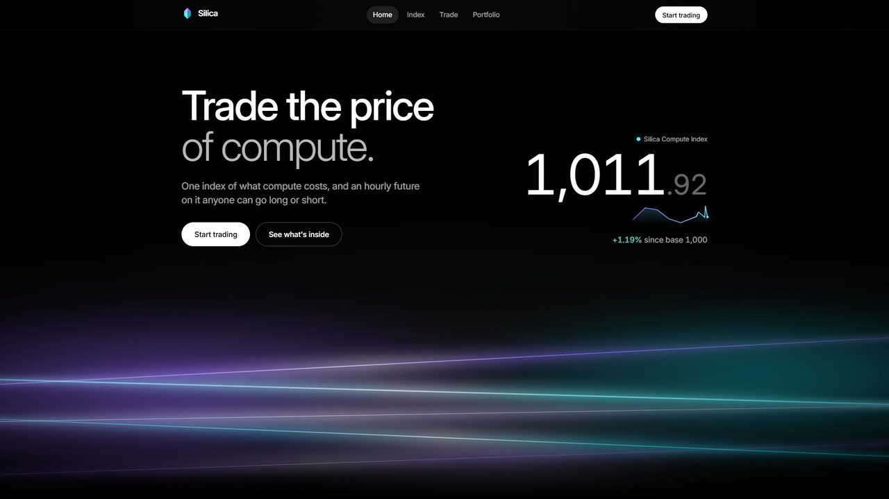
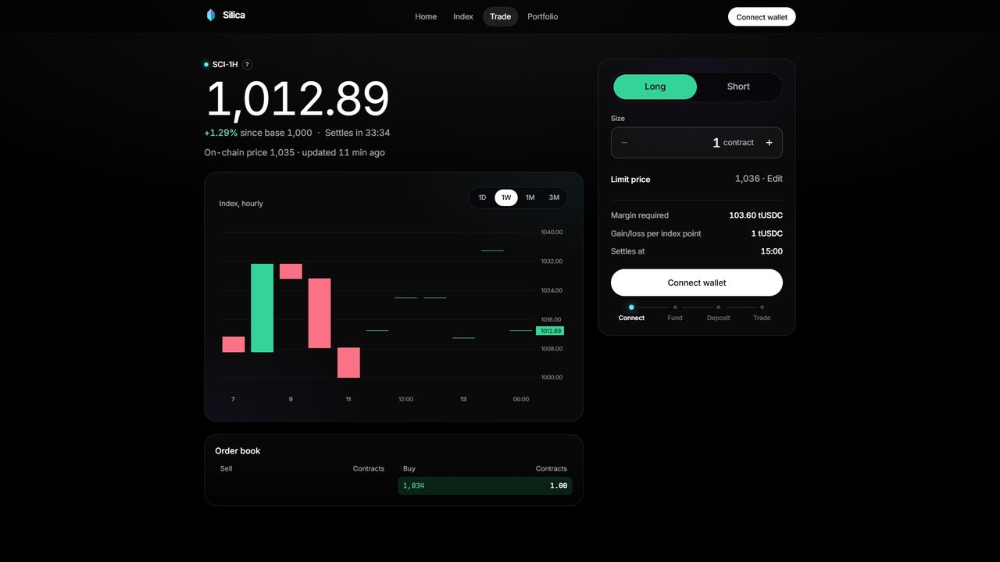

<div align="center">

# Silica

**Trade the price of compute.**

One live number for what compute costs, and an hourly futures market on it that settles on NEAR.

[](https://github.com/zishaan1911/near-hackathon-2026/actions/workflows/tests.yml)   

[Live app](https://silicaindex.vercel.app) · [Methodology](docs/compute-index.md) · [Contract ABI](docs/near-abi.md) · [Architecture](docs/architecture.md)



</div>

---

## Why this exists

Right now, the same NVIDIA H100 rents for **$2.73 an hour** on one marketplace and **$4.39** on another. Same chip, same hour, 61% apart. For an A100 the gap is wider still.

Oil has a benchmark price. So do gold, wheat and electricity. Compute, the input every AI product runs on, has a dozen prices scattered across GPU marketplaces, clouds, inference APIs and mining pools. Nobody can point to one number and say "this is what compute costs today", and nobody can hedge against it going up.

The people exposed to that price are everywhere:

- **AI startups** whose biggest bill is GPU time.
- **GPU owners and lessors** whose income depends on rental rates.
- **Miners and validators** whose margins move with hashprice and blockspace demand.
- **Anyone with a view** on AI demand, who today can only express it by buying chip stocks.

Silica gives them a benchmark and a market.

## What Silica does

1. **Measures.** Every minute, the index engine collects public prices for six kinds of compute and combines them into the **Silica Compute Index (SCI)**.
2. **Publishes.** An oracle account writes the index to a NEAR contract, with freshness and range checks enforced on-chain.
3. **Lists a future.** `SCI-1H` is an hourly, cash-settled future on the index. A long position gains 1 tUSDC for every point the index rises; a short gains when it falls.
4. **Settles.** At the end of each hour the contract settles at the published index, and the next hourly market opens automatically.

### The six pillars

| Pillar | Weight | What it measures | Sources |
|---|---:|---|---|
| GPU rental | 35% | H100, A100 and RTX 4090 hourly rates | Vast.ai, RunPod, Akash |
| Cloud GPU spot | 20% | Spot price of GPU instances | AWS, Azure |
| AI inference | 20% | Blended $ per 1M tokens across an 8-model basket | OpenRouter |
| Cloud CPU spot | 10% | Spot price of general compute instances | AWS, Azure |
| Bitcoin hashprice | 10% | Miner revenue per unit of hashrate | blockchain.info, CoinGecko |
| Ethereum blockspace | 5% | 7-day median cost of 1M gas, in dollars | Ethereum RPC |

The index uses a **matched-quote method**: each quote is compared only with its own starting value, never with another venue's price. A venue going offline or a new venue appearing cannot move the index by itself. The base is **1000 on 2026-11-11**. The full methodology is in [docs/compute-index.md](docs/compute-index.md).

## See it

| Home | Trade |
|---|---|
|  |  |

## Try it in two minutes

1. Open **https://silicaindex.vercel.app**. You see the live index and its six pillars.
2. Open **Index** for the history chart, the GPU price board ("Same chip. Different price.") and a live compute news feed.
3. Open **Trade** and connect a NEAR testnet wallet (MyNearWallet, Meteor or HERE).
4. Press **Try a demo trade**. It walks you through getting 1,000 test tUSDC from the faucet, depositing margin and going long or short.
5. Keep the size at 1 contract. A demo market maker quotes both sides, so your order fills within about 15 seconds and you see "Filled at …" under the button.
6. After the hourly settlement, open **Portfolio** and press **Claim**. Your profit or loss is credited to your balance.

### A worked example

You go long 1 contract at **1,013**. Margin is 10% of the notional, so the order locks about 101 tUSDC. The hour ends and the market settles at **1,035**. You claim **+22 tUSDC** (1 tUSDC × 22 points), and the short side loses the same amount.

Payouts are capped by the margin both sides locked: you can never lose more than your own margin, and never win more than your counterparty's.

## How NEAR is used

| Piece | What it does |
|---|---|
| **Settlement contract** ([`contracts/near/silica`](contracts/near/silica), Rust, `near-sdk` 5) | Margin accounts, limit orders, on-chain matching with every check inside the contract, an oracle with freshness and price-range limits, hourly settlement and pull-based payouts. Every action emits a NEP-297 event. |
| **Collateral** ([`contracts/near/mock-ft`](contracts/near/mock-ft)) | A NEP-141 token with a public faucet, deposited with `ft_transfer_call`. |
| **Wallets** | NEAR Wallet Selector. Users sign every order themselves; the server prepares transactions but never holds user keys. |
| **Upkeep** | A scheduled tick signs with a dedicated oracle account to publish the index, settle the expired market, roll to the next hour and match crossing orders. `roll_market` cannot change any market parameter, so the tick never needs the owner key. |

Deployed accounts: contract `gasx.testnet`, collateral `tusdc.gasx.testnet`, oracle `oracle.gasx.testnet`.

## Architecture

```
price sources ──▶ index engine ──▶ oracle account ──▶ Silica contract on NEAR ◀── your wallet
                      │                                       ▲
                      └──▶ website + API (Vercel) ────────────┘
                                 unsigned transactions for your wallet to sign
```

| Path | What it is |
|---|---|
| `contracts/near/silica` | Settlement contract (Rust) with unit tests |
| `contracts/near/mock-ft` | Test collateral token with a faucet |
| `server` | API (Fastify): index engine, market reads, transaction preparation, upkeep tick, news feed |
| `blockchain/near` | NEAR adapter: chain reads, transaction builders and the upkeep tick |
| `frontend` | Web app (React, Vite, Lightweight Charts) |
| `api/index.js` | The server bundled for Vercel; regenerate with `npm --prefix server run build:vercel` |
| `supabase/migrations` | Optional Postgres storage for index snapshots and the cron schedule |
| `docs` | Methodology, contract ABI, market design and architecture notes |

## Run it locally

You need Node.js 20 or newer. Rust and `cargo` are only needed for the contract tests.

```bash
npm --prefix blockchain/near ci && npm --prefix blockchain/near run build
npm --prefix server ci && npm --prefix server run dev      # API on :3000
npm --prefix frontend ci && npm --prefix frontend run dev  # app on :5173, proxies /api
```

- Configuration lives in `.env.example`. With no contract configured, the API runs in a read-only dev-market mode.
- Run every test suite with `bash scripts/test-all.sh`.
- Deploy your own contract with `scripts/deploy-near.sh` (needs `near-cli-rs`).

## Roadmap

- Several independent publishers with a median price and slashing.
- Time-weighted settlement and longer-dated markets (daily, weekly).
- Sub-indices that trade on their own, starting with H100 rental.
- Real stablecoin collateral on mainnet, with an independent market maker instead of the demo quotes.

## Built for NEAR HACKATHON

Silica was built for **NEAR HACKATHON** (2026-11-01 to 2026-11-14), in the **Unstoppable DeFi** track.

Silica started as a fork of [GASX](https://github.com/zishaan1911/GASX), the author's earlier project (Ethereum gas futures on Sui); the first commit on this branch is that import. During the hackathon it was rebuilt for NEAR and turned into a compute index. A few server files (risk policy, chat route, config) still descend from it.

## Credits

- **Photos:** Wikimedia Commons, under CC BY, CC BY-SA, CC0 or public domain. Authors and licences are listed in the app under **Image credits** and in `frontend/src/lib/imageCredits.json`.
- **Charts:** [TradingView Lightweight Charts](https://www.tradingview.com/lightweight-charts/).
- **Libraries:** `near-sdk`, `near-contract-standards`, `near-api-js`, NEAR Wallet Selector, Fastify, `postgres`, React, Vite and Motion.
- **Tools:** parts of the code and documentation were written with AI coding assistants and reviewed by the author.

## License

[MIT](LICENSE)
